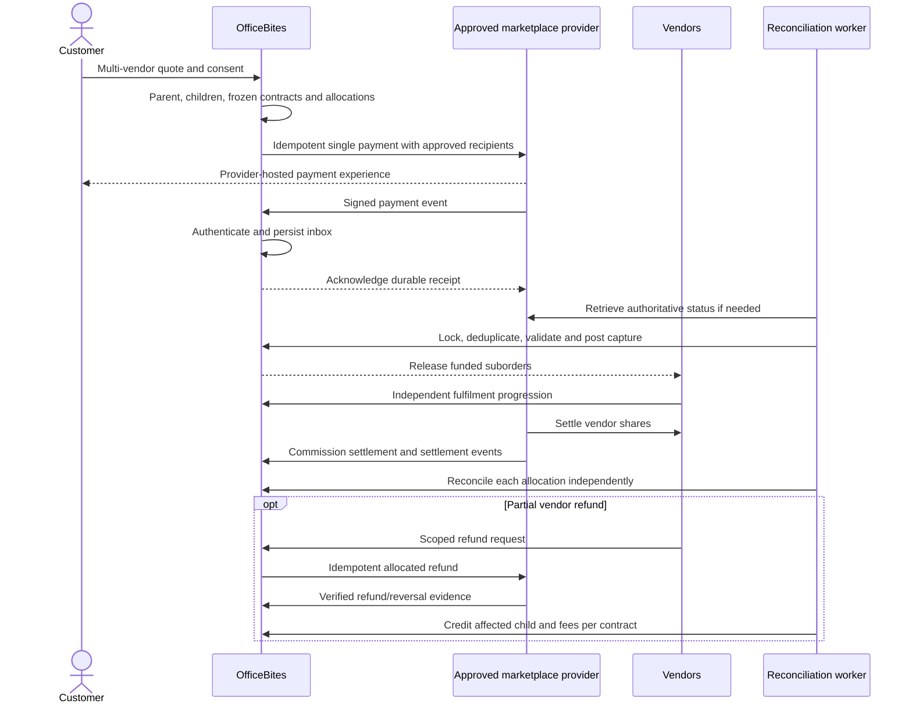

# OfficeBites marketplace architecture proposal

Date: 2026-10-21. Status: design only; no implementation or provider approval implied.

## Scope and evidence

Reviewed local source on `feat/vendor-direct-launch-payments`, including uncommitted implementation already present. This is a source audit, not a hosted schema attestation. No hosted queries, changes, deployments or payment activation were performed for this design. Existing staging installation reports describe earlier observations and must be revalidated before any migration.

Primary evidence:

- `supabase/migrations/0001_core_schema.sql`: orders, order_suborders and order_items already form a parent/child hierarchy.
- `20261007141325_harden_live_order_and_chat_permissions.sql`: vendor-scoped fulfilment RPC, parent-first locking, sequential progression and least-advanced-child parent status.
- `20261008114505_launch_financial_ledger.sql`: paid commission snapshots, reporting, business audit, vendor_payouts and payout_allocations. Allocation reserves accounting amounts; it does not transfer money.
- `20261016074256_checkout_recovery_mobile_delivery_gateways.sql`: private payment_attempts, gateway settings and delivery quotes.
- `20261016083644_ozow_attempts_subscription_approval.sql`: provider-specific attempts, receipts and delivery deduplication. Existing infrastructure is not evidence of merchant approval.
- `20261016090258_central_hub_vendor_origin_approval.sql` and `20261016092359_delivery_unenforced_order_snapshots.sql`: Eduvos central hub, approved origin alternatives, quote revisions and immutable suborder delivery snapshots.
- `20261016094201_legal_corporate_framework.sql`: legal versions, vendor acceptances, standard sale contracts and a disabled standard fee-breakdown framework.
- `20261020090841_vendor_direct_manual_payments.sql`: single-vendor checkout enforcement, approved recipient versions, protected order snapshots, customer reports, receipt verification, receivables and refund/dispute events.
- `20261021094956_fix_admin_manual_settings_singleton.sql`: targeted settings singleton correction; unrelated to the future data model.
- `src/context/CartContext.jsx`, `src/services/orderService.js`, `src/services/manualPaymentService.js`, `src/utils/orderState.js`: single-vendor cart replacement, guest access, RPC contracts and payment/fulfilment presentation.

## Business boundaries

Phase 1 remains one vendor per checkout. The customer transfers directly to the vendor, the vendor independently checks its bank receipt, and OfficeBites invoices commission separately. A customer payment report is a claim, never settlement evidence. Existing admin receipt-review exceptions remain controlled and audited; they must not become automatic confirmation.

Phase 2 permits multiple vendor suborders under one customer order only through a provider explicitly approved for this marketplace model. The provider receives and settles funds under its authorised arrangement; OfficeBites does not collect customer funds in its own bank account or operate an internal splitting account. Sellers remain responsible for their sales, fulfilment and refunds. Exact contractual and accounting responsibilities require review before implementation.

The agreed standard commercial schedule is 15% platform plus 2% transaction-related fee, subject to vendor agreement. The 2% is not assumed to equal the provider's actual charge. No default overrides an accepted vendor-specific agreement. PayFast and Ozow remain blocked for new third-party payments, and their historical callbacks and records remain available for reconciliation.

## Findings and gaps

| Area | Existing support | Gap or constraint |
| --- | --- | --- |
| Orders | Parent orders, vendor suborders, child items | Reuse hierarchy; do not introduce a second parent-order table. Mixed child cancellation/refund aggregation needs a versioned model. |
| Checkout | Server-calculated prices; manual request key/hash and one-vendor validation | Multi-vendor basket/quote orchestration intentionally absent from launch. |
| Payments | Legacy attempts and provider receipts; one manual payment per order | No provider-independent authoritative intent model found in reviewed migrations; manual model cannot represent several vendor recipients. |
| Recipients | Private versioned profiles, independent approval, immutable destination copied into order | Provider-connected seller accounts, onboarding capabilities, revocation and settlement recipient snapshots missing. Private schema access restrictions do not establish application-level encryption. |
| Fees | Vendor commission defaults to 0.17; paid-transition snapshots | Current snapshot is taken at verification, not checkout. Future contracts must freeze fees before accepting payment. Disabled 15/2 framework cannot be silently activated. |
| Receivables | One immutable receivable per manual order; append-only collections/refunds/credits | Separate invoice issuance, invoice lines, credit notes and reconciliation needed; no new provider payout payable should be created for vendor-direct funds. |
| Payouts | Allocation records and manual reconciliation | Not a provider settlement engine. Current one-active-allocation-per-suborder constraint cannot represent split settlement legs/retries. |
| Refunds/disputes | Manual refund events, capped receivable adjustments, fulfilment holds | Need child/item allocation, asynchronous provider refund lifecycle, chargebacks and settlement reversals. |
| Permissions | Vendor ownership, active admin checks, private tables and RLS | Parent visibility can expose shared columns; audit all projections, SECURITY DEFINER RPCs, reports, chat and Realtime for sibling-vendor leakage. |
| Delivery | Central hub policy plus approved alternatives and quote snapshots | Preserve policy; mixed-vendor readiness and delivery-charge refund ownership need explicit rules. |

## Proposed logical model

Names below are proposals, not executable SQL. Existing identifiers and API shapes remain valid for legacy and manual orders. New private financial tables have no direct anon/authenticated access; access is through scoped projections/RPCs.

| Entity | Keys and responsibilities |
| --- | --- |
| `orders` (existing) | Customer/guest owner, ticket, currency, total, delivery date/location; additive `architecture_version` and `payment_mode` distinguish legacy, vendor_direct and approved_marketplace. Keep legacy status projection. |
| `order_suborders` (existing) | Parent FK, vendor FK, product totals, separate payment/fulfilment/refund/hold projections. For new version enforce one child per `(order_id,vendor_id)` after duplicate audit, not blindly across history. |
| `order_items` (existing) | Immutable seller, description, price, quantity and applicable tax/discount snapshots through child ownership; refundable quantities tracked separately. |
| `sale_contract_snapshots` | One per new child: accepted agreement/version/hash, seller identity, fee components/base/tax/rounding policy, product and delivery allocations, calculation version. Reuse/reference existing legal acceptances; snapshot values, not just mutable pointers. |
| `payment_intents` | One immutable payable obligation/version per order, mode, currency, expected amount, quote/contract hashes, lifecycle, expiry. Unique order/version. At most one current payable intent per order. Old cancelled intents and money received against them remain reconcilable. |
| `payment_attempts_v2` | Intent FK, provider/account/environment, request key and payload hash, external payment ID, amount, normalized status and timestamps. Several historical attempts; only one unresolved actionable attempt per intent. Keep legacy attempts unchanged. |
| `provider_seller_accounts` | Vendor/provider/environment scoped onboarding and capabilities, external account identifier, approval/revocation evidence. Store references, not credentials or customer bank secrets. |
| `recipient_snapshots` | Child/attempt allocation FK, immutable approved recipient version and opaque provider destination/account reference. Manual orders retain their existing private destination snapshots; no public cross-vendor destination list. |
| `payment_allocations` | Intent/child allocation of merchandise, delivery, discounts/tax and gross collected amount. Composite FK or server constraint proves child belongs to intent's order. Sum equals intent amount. |
| `settlement_allocations` | Allocation/recipient, beneficiary type, gross basis, fee components and net expected amount. Provider settlement batches/legs and append-only confirmations/reversals record actual delivery of funds independently of customer capture. |
| `provider_event_inbox` | Unique `(provider,environment,merchant_account,event_id)`, verified payload hash, received/event times, processing status, redacted evidence and retry details. Separate delivery IDs from underlying financial transaction IDs. |
| `financial_journals` / `journal_lines` | Append-only balanced postings in minor units, currency, vendor/child/intent provenance and unique business-event posting key. Record provider clearing as reconciliation evidence, not OfficeBites bank custody. Accountant approves account mapping. |
| `refunds` / `refund_allocations` | Request key/hash, attempt/capture FK, provider refund ID, child/item/product/delivery/tax allocations, lifecycle and evidence; cumulative reservations prevent concurrent over-refund. |
| `disputes` / `dispute_events` | Provider case ID, affected capture/children, disputed amount, deadline, evidence references, holds and final outcome. |
| `commission_invoices` / lines / credits | Phase 1 vendor debt from existing receivables, agreement/tax snapshot, invoice number and due date; immutable issued invoice with additive credit notes and collection allocations. Provider-withheld Phase 2 commission must not also remain collectible debt. |
| `outbox` | Transactional notification/reconciliation jobs with unique event key; notification dispatch remains subject to staging suppression controls. |

Money uses integer minor units for new postings and adapter boundaries; convert existing ZAR numeric amounts exactly without float arithmetic. Never mix currencies in an intent or balanced journal. Allocation sums and per-capture refund limits are transactionally enforced under locks, not only UI validation.

Snapshots freeze at new checkout commitment: server-priced item values, agreement and fee bases, 15% and 2% component rates/amounts where agreed, actual provider-fee policy separately, currency, tax treatment, delivery policy/revision/origin and charge allocation, recipient approval and provider account/environment. Financial amounts cannot change after commitment; changes require a new quote/intent and consent. Recipient rotation affects only future orders; revoked unsafe recipients place pending attempts on review rather than silently reroute funds. Minimise retained banking data, restrict/decrypt only for authorised instructions, redact logs and apply an approved retention/key-management policy.

Example, assuming an agreed product-only fee base and no tax adjustment: R100 products yields R15 platform plus R2 transaction-related commission. Delivery is allocated separately under the approved policy. The provider's own fee is a distinct contractual cost. These assumptions must be confirmed, not inferred for historical sales.

## State transitions and invariants

- Phase 1 keeps existing states and RPCs unchanged: awaiting_payment → payment_reported → paid only after authorised independent verification; expiry, under_review and disputed paths remain controlled. Reported funds never release fulfilment. Existing order-level receivables stay authoritative.
- New intent: pending → processing → paid, or failed/cancelled/expired only after definitive evidence. Ambiguous timeout remains processing/review; prohibit a new charge while outcome is unknown. Late confirmed funds after cancellation enter exception/refund review, not automatic fulfilment.
- Attempt: created → submitted → pending → succeeded/failed/cancelled; optional authorization/capture states only when the approved provider supports them. Persist actual money events even if they contradict an earlier local status. Browser return URLs cannot establish success.
- Child payment: unpaid → pending → paid from verified capture allocation; partial captures stay on hold in the initial Phase 2 design. Require full exact-order capture before releasing any child; otherwise reconcile/refund. Refund/dispute dimensions remain separate, so paid history is never erased.
- Child fulfilment: pending_payment → confirmed → accepted → preparing → ready → collected → completed. Gate each transition on verified allocated funds and no applicable hold. Cancellation before fulfilment is a separate controlled path; after money receipt it starts/refers to refund handling. No arbitrary backwards edits.
- Parent fulfilment is derived under parent-first locking: all cancelled → cancelled; all non-cancelled completed → completed with cancellation/refund summary; some terminal and some active → partially_completed; otherwise least advanced active child plus holds. Expose partial cancellation explicitly. New aggregate values belong to a versioned API; do not add enum values that break current clients.
- Parent payment is an aggregate of child capture/refund balances, with separate dispute and settlement summaries. Captured is not settled; completed delivery is not proof of payment. Settlement failure never changes a paid sale back to unpaid or prompts customer repayment.
- Refund: requested → approved/reserved → submitted → pending → succeeded/failed/review. Release a reservation only on verified failure. Dispute: opened → evidence_submitted → won/lost/closed, independently retaining history.

## Phase 1 sequence (unchanged)

```mermaid
sequenceDiagram
  actor C as Customer or guest
  participant A as OfficeBites
  participant V as Vendor and vendor bank
  participant L as Commission records
  C->>A: Single-vendor checkout and method
  A->>A: Validate availability, quote and approved profile
  A-->>C: Pending order and protected recipient snapshot
  C->>V: Direct PayShap/EFT outside OfficeBites
  C->>A: I've made payment
  A->>A: Record claim only; retain unpaid state
  V->>V: Independently verify bank receipt
  V->>A: Authorised receipt confirmation
  A->>L: Paid snapshot and one receivable atomically
  V->>A: Accept, prepare, ready, collect, complete
  A->>V: Separately issued commission invoice
```

## Future approved-provider sequence



## Provider-independent integration contract

This is an internal design, not a claim about any provider API. Adapters must advertise supported capabilities and fail closed for unsupported operations.

Operations: `getCapabilities(account, environment)`, `validateSeller(accountRef)`, `createPayment(intent, allocations, idempotencyKey)`, `getPayment(externalId)`, `cancelPayment(...)`, `createRefund(capture, allocations, key)`, `getRefund(...)`, `verifyAndNormalizeWebhook(rawBody, headers)`, `listSettlements(cursor)` and `getSettlement(id)`. Credentials stay server-side, scoped separately to staging/production. No provider selection or bank details supplied by the browser are trusted.

Input includes immutable IDs, amount/currency, seller account references, contract/recipient hashes and correlation key. Output includes external IDs, normalized outcome, raw provider status, evidence reference, occurrence timestamp and retryability. Redirect URLs are allowlisted and carry no secrets. A missing capability or unapproved account disables initiation; no automatic fallback to PayFast/Ozow or OfficeBites bank details.

Webhook processing verifies signature against raw bytes, account, environment and replay rules before accepting evidence. Persist first, then transactionally lock parent, intent, attempts and affected children in stable order. Validate currency, expected amount, provider transaction ownership and allocation totals; deduplicate both event IDs and capture/refund/settlement operation IDs. Insert unique journal keys, update projections and enqueue outbox work in the same transaction. Invalid/mismatched evidence enters restricted review without releasing fulfilment. Acknowledgement/retry semantics must follow the selected provider's documented protocol.

Duplicates are successful no-ops after durable processing; same event ID with different payload hash is a security exception. Out-of-order events trigger authoritative lookup and monotonic money-event reconciliation. Scheduled reconciliation retrieves missing captures, refunds and settlements using durable cursors; retry with bounded backoff and operator alerts. Never fabricate success after retry exhaustion.

If two attempts both collect money, retain both captures, allocate the payable amount only once, hold the excess as a reconciliation exception and obtain an authorised refund. Never create a second commission or fulfilment instruction. For partial refunds reserve remaining item/product/delivery amounts under lock, apply cumulative rounding, and credit only contractually refundable fees. Refund and chargeback accounting must not double-credit the same loss. Failed or short settlements produce a provider exception and seller-specific hold/recovery workflow; no automatic debit, cross-vendor offset or rerouting without contractual authority.

## Access controls and delivery

Vendor reads and commands derive vendor identity from authenticated membership/ownership and active approval; supplied vendor IDs never grant authority. Limit vendors to their child items, financial allocations, fulfilment data and necessary customer contact. Do not expose sibling identities, amounts, recipient details, disputes or messages through parent rows, joins, reports or Realtime. Use explicit vendor projections rather than returning whole parent JSON. Customers see their own parent and children; guest access uses narrowly scoped capability checks with rate limiting and redacted errors. UUID knowledge alone grants nothing.

Use RLS on exposed tables, least-privilege grants, fixed-search-path narrowly granted security-definer RPCs and security-invoker views where appropriate. No client writes to money, approval or payment status. Admin actions require active role checks, reason, immutable evidence and independent approval for recipient changes; apply separation of duties to exceptional refunds/settlements. Provider workers have narrowly scoped server privileges, not browser service-role keys. Test REST, RPC, Storage, Realtime and Edge paths, not only UI restrictions.

Keep the existing Eduvos-centred policy, configured enforcement state, hub verification gates, radius/fee rules and approved-origin exceptions unchanged. Existing source records 0.5 km free radius, 5 km maximum and R15 paid fee as configured defaults; these are not newly activated or asserted as current hosted settings. Future checkout must validate every child's serviceability against the same policy revision and reject an unsupported basket rather than silently expand geography. Freeze origin and charge allocation per child, ensure allocated charges equal the parent delivery fee, and preserve quote expiry/use-once checks. Operational handoff between several vendors and the hub requires a separately approved plan; schema support alone does not authorise new delivery operations.

## Backward-compatible migration and recovery plan

1. Inventory deployed schema/history and dependencies read-only, including local/hosted timestamp differences. Capture schema/ACL/RLS, row fingerprints, callback behaviour and a tested recovery checkpoint. Audit duplicate children and existing unknown commission values before proposing constraints.
2. Add new private tables and nullable/versioned fields with deny-by-default grants. No historical rewrites, bank-profile copying, gateway unblocking or old-attempt migration. Assess FK validation, index construction, lock duration and enum/client compatibility before rollout.
3. Build new read models behind an inactive version gate. Legacy/manual projections read existing authoritative tables; new ledgers do not also post those same sales. Historical entries remain labelled legacy/unknown where snapshots are absent. Any provenance-backed backfill is a separately reviewed operation.
4. Introduce new-version writers and fee/recipient freezing only for future approved flows. Preserve existing RPC signatures, single-vendor validation and manual confirmation semantics. Do not reuse or relax the current blocked legacy attempt table to add a new provider.
5. Prove local invariants, concurrency and recovery, then obtain separate staging migration, fixture and notification-isolation approvals. No new provider activation until signed marketplace approval, seller onboarding and settlement/refund evidence exist.
6. Run provider sandbox contract/reconciliation tests and supervised staging UAT under separate approval. Enable future multi-vendor traffic only after operational, commercial and security acceptance; keep manual single-vendor checkout available as its own deliberate flow, never an automatic ambiguous-payment retry.

Recovery disables only new initiation and routing, retains callback/reconciliation workers for in-flight money, and switches compatible clients to the established single-vendor flow. Do not drop new history or reverse captured payments by schema rollback. Restore schema/configuration only through an approved tested procedure; reconcile every in-flight attempt before retiring an adapter. Preserve historical PayFast/Ozow processing and existing receivables. Restoring the old no-hook Auth baseline is not notification suppression and is not part of this design rollout.

## Minimal roadmap, regression evidence and approvals

| Stage | Smallest deliverable | Required evidence / exit condition |
| --- | --- | --- |
| 0: Phase 1 operations | Finish existing admin save retest and separate security/UAT prerequisites; vendor agreements, approved recipients and commission invoicing procedure | No payment activation implicit; prove reporting is unpaid, verification is independent, receivable created once and no platform collection. |
| 1: Contracts | Agree fee base, 15/2 exceptions, tax, actual provider fee responsibility, refund credits, delivery allocation, settlement timing and liability | Approved versioned seller/customer terms and accountant-reviewed postings; provider marketplace approval still required. |
| 2: Local foundation | Versioned schema/read projections and invariant tests, no checkout change | Legacy/manual golden responses unchanged; no duplicate ledger/receivable; all new tables deny unauthorized access. |
| 3: Adapter sandbox | Approved provider contract, event inbox/outbox and reconciliation | Signature/account/environment rejection; duplicate/out-of-order/missing events; timeout and retry; exact capture/refund/settlement conservation. |
| 4: Multi-vendor orchestration | New-version basket, child quote/contract snapshots and aggregate presentation | Concurrent vendor changes, recipient revocation, stale quotes, duplicate request with changed payload, partial cancellation and delivery allocation tested. |
| 5: Controlled rollout | Separately approved staging and limited operational release | Seller onboarding, sandbox settlement and refund evidence, support runbooks, monitoring, recovery drill and explicit activation approval. |

Regression matrix: existing guest checkout/capability isolation; cart preservation; eligible-method display plus backend recheck; disabled PayFast/Ozow initiation with historical reconciliation retained; protected recipient snapshots after banking changes; payment-report claims never paid; paid/fulfilment locks and independent vendor progression; mixed cancellation/completion; refund quantities and cumulative rounding; concurrent refunds/chargebacks; duplicate captures and invoice collections; zero/negative/overflow/currency errors; per-vendor data isolation across every transport; existing order API and mobile layout; delivery quote revision, serviceability and Eduvos policy; no real notifications during synthetic tests. Run existing suites when implementation begins, plus focused tests for each new writer; no regression suite was rerun for this documentation-only task.

Primary risks: unapproved provider business model, premature fee changes, leakage through parent projections, double-counted commission, asynchronous money contradictions, historical migration drift, callback breakage, over-refunds and unsupported delivery coordination. Provider approval, legal/commercial/tax decisions, onboarding, operational refund authority and separate hosted security/UAT approvals are dependencies, not assumptions.

Decision: retain Phase 1 architecture and finish its existing controls. Proceed next with contract and accounting decisions, then local additive foundations. Phase 2 implementation and activation are not ready to approve from schema reuse alone.
